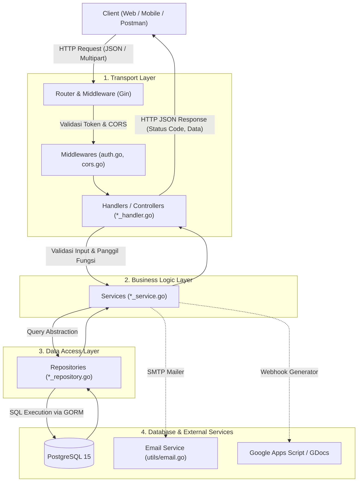
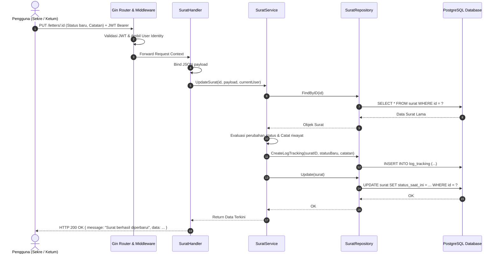
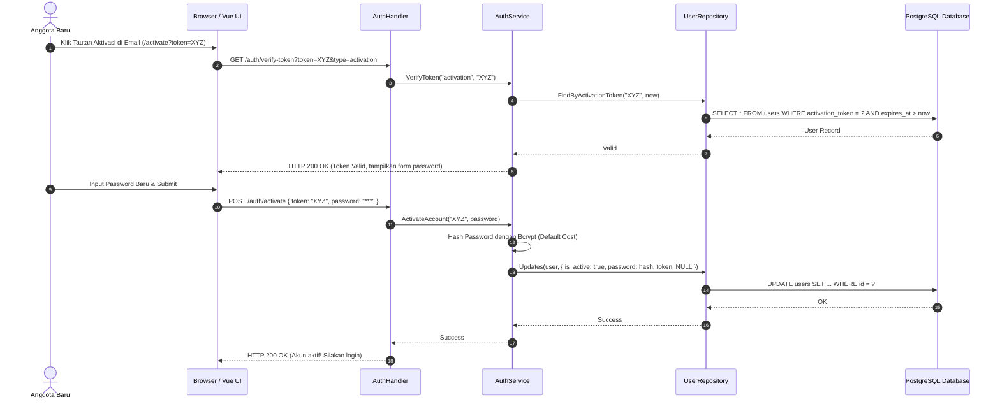

# Bedah Arsitektur & Alur Backend LACI (Layanan Administrasi & Catatan Informasi)
> **Mata Kuliah:** Pemrograman Sisi Server / Pemrograman Back-End  
> **Teknologi Utama:** Golang (Gin Gonic Framework), GORM ORM, PostgreSQL, Docker  
> **Pola Desain:** *Clean Layered Architecture* (*Controller/Handler &rarr; Service &rarr; Repository &rarr; Model*)

---

## 1. Gambaran Umum Arsitektur (Architectural Overview)

Backend LACI dirancang menggunakan prinsip **Separation of Concerns (SoC)** dengan memisahkan kode ke dalam 4 lapisan (*Clean Layered Architecture*). Setiap lapisan memiliki tanggung jawab tunggal (*Single Responsibility Principle*):



---

## 2. Struktur Folder & Peran Setiap Komponen

```
backend/
├── main.go               # Entry point eksekusi server
├── config/               # Inisialisasi DB, migrasi, dan konfigurasi environment
├── models/               # Entitas skema database (struct model GORM)
├── middlewares/          # Filter request: validasi JWT dan proteksi CORS
├── routes/               # Pendaftaran endpoint & Dependency Injection
├── handlers/             # HTTP controller (parsing payload, status code, response)
├── services/             # Business logic (logika bisnis, aturan validasi, hash)
├── repositories/         # Layer akses data (GORM query & CRUD database)
├── seeders/              # Seeder data awal (akun genesis & template)
├── utils/                # Helper (generator token, email SMTP, JWT helper)
└── uploads/              # Penyimpanan fisik file arsip surat (static files)
```

---

### A. `backend/main.go` (Server Entrypoint)
* **Tanggung Jawab:** Berkas utama yang pertama kali dieksekusi oleh Go runtime.
* **Tugas Spesifik:**
  1. Membaca berkas `.env` menggunakan `godotenv`.
  2. Menginisialisasi koneksi basis data melalui `config.InitDB()`.
  3. Menyediakan CLI argument parser via flag `-seed` (`go run main.go -seed`) untuk memuat data dummy pengujian secara instan.
  4. Menjalankan *Core Seeder* (`seeders.SeedCore`) untuk memastikan akun administrator default (Genesis Ketum/Sekre) dan template awal selalu tersedia saat aplikasi pertama kali boot.
  5. Mendaftarkan routing via `routes.SetupRoutes(r)`.
  6. Menjalankan HTTP engine Gin pada port yang ditentukan (default `8080`).

---

### B. `backend/config/` (Konfigurasi & Database Lifecycle)
* **Berkas:** `database.go`
* **Tanggung Jawab:** Manajemen siklus hidup basis data PostgreSQL.
* **Fitur Utama:**
  * **Connection Pooling:** Mengatur batas maksimal koneksi aktif (`SetMaxOpenConns`) dan koneksi idle (`SetMaxIdleConns`) untuk mencegah *exhaustion* koneksi database.
  * **Auto Migration:** Melakukan sinkronisasi otomatis struct Go ke tabel fisik PostgreSQL (`db.AutoMigrate(...)`).
  * **Migrasi Idempoten / Raw DDL:** Menangani penyesuaian skema aman (misal menambahkan kolom `is_active`, token reset password, dan indexing) tanpa menghilangkan data yang sudah ada.

---

### C. `backend/models/` (Data Modeling & ORM Mapping)
* **Berkas:** `models.go`
* **Tanggung Jawab:** Mendefinisikan kontrak struktur data tabel PostgreSQL menggunakan tag GORM dan JSON serialization.
* **Entitas Utama:**
  1. `User`: Manajemen pengguna (NIM, Nama, Email, Username, Password hash, Divisi, IsKoor, Status Aktivasi, Token).
  2. `Surat`: Entitas inti arsip (Nomor surat, Perihal, Tujuan, Status Kanban, PIC Nama, Relasi Proker, Link Google Docs).
  3. `LogTracking`: Audit trail riwayat perjalanan surat (SuratID, Status Baru, Catatan Log, Timestamp). Terhubung secara *1-to-Many* dengan `Surat`.
  4. `Proker`: Program kerja divisi organisasi DOSCOM.
  5. `SuratTemplate`: Metadata template persuratan resmi (Placeholder fields, Google Drive ID).
  6. `Instansi`: Master data instansi tujuan / mitra relasi eksternal.
  7. `AppSetting`: Variabel dinamis sistem (misal: format nomor surat, URL webhook).

---

### D. `backend/middlewares/` (Request Interceptor)
* **Berkas:** `cors.go`, `auth.go`
* **Tanggung Jawab:** Menyaring setiap request sebelum masuk ke logic controller.
* **Implementasi:**
  * **`CORSMiddleware`**: Mengatur header *Cross-Origin Resource Sharing* (`Allow-Origin`, `Allow-Headers`, `Allow-Methods`) agar frontend SPA (Vue.js/React) dapat mengakses API backend secara aman.
  * **`AuthMiddleware`**:
    1. Membaca header `Authorization: Bearer <token>`.
    2. Melakukan verifikasi kriptografi token JWT via `utils.ValidateJWTToken`.
    3. Mengekstrak klaim pengguna (`user_id`, `username`, `divisi`, `is_koor`) dan menyuntikkannya ke dalam konteks Gin (`c.Set(...)`) sehingga dapat diakses langsung oleh handler di bawahnya.

---

### E. `backend/routes/` (Routing & Dependency Injection)
* **Berkas:** `setup.go`
* **Tanggung Jawab:** Pusat deklarasi endpoint RESTful API dan perakitan dependensi (*Wiring*).
* **Konsep Penting (Dependency Injection):**
  * Route berfungsi sebagai pabrik perakit:
    $$\text{Database (config.DB)} \longrightarrow \text{Repositories} \longrightarrow \text{Services} \longrightarrow \text{Handlers} \longrightarrow \text{Route Endpoints}$$
  * Membagi rute menjadi 2 kelompok besar:
    1. **Public Routes:** `/login`, `/programs`, `/auth/verify-token`, `/auth/activate`, `/auth/forgot-password`, `/auth/reset-password`.
    2. **Protected Routes (Grup `authGroup` dengan `AuthMiddleware`):** `/profile`, `/users`, `/letters`, `/instansi`, `/settings`, dll.

---

### F. `backend/handlers/` (HTTP Controller / Transport Layer)
* **Berkas:** `auth_handler.go`, `surat_handler.go`, `user_handler.go`, `proker_handler.go`, `template_handler.go`, `instansi_handler.go`
* **Tanggung Jawab:**
  * Menangani protokol HTTP (membaca JSON body, form-data upload file, path parameter `:id`, query parameters).
  * Validasi awal masukan format (contoh: panjang minimum kata sandi).
  * Meneruskan data yang sudah divalidasi ke *Service*.
  * Mengembalikan respon terstandarisasi dengan status code HTTP yang sesuai (`200 OK`, `201 Created`, `400 Bad Request`, `401 Unauthorized`, `403 Forbidden`, `500 Internal Server Error`).

---

### G. `backend/services/` (Business Logic Layer)
* **Berkas:** `auth_service.go`, `surat_service.go`, `user_service.go`, `proker_service.go`, `template_service.go`, `instansi_service.go`
* **Tanggung Jawab:** Jantung aplikasi tempat seluruh aturan bisnis berada:
  * **Otentikasi & Keamanan:** Hashing password dengan Bcrypt, verifikasi masa kedaluwarsa token aktivasi/reset, otorisasi RBAC (Role-Based Access Control antar Divisi/Sekre/Ketum).
  * **Audit Trail Otomatis:** Setiap kali status surat berubah di `surat_service.go`, sistem otomatis menyisipkan rekaman ke tabel `log_tracking`.
  * **Import Massal:** `user_service.go` memproses import user dari CSV atau Spreadsheet, parsing baris, pembuatan username otomatis, dan pemicuan email aktivasi secara asinkron.
  * **Integrasi Eksternal:** `template_service.go` memicu webhook Google Apps Script untuk otomatisasi format surat berbasis Google Docs.

---

### H. `backend/repositories/` (Data Access Layer)
* **Berkas:** `user_repository.go`, `surat_repository.go`, `proker_repository.go`, `template_repository.go`, `instansi_repository.go`
* **Tanggung Jawab:** Berinteraksi langsung dengan basis data menggunakan library ORM GORM.
* **Manfaat:** Jika terjadi perubahan database (misal beralih dari PostgreSQL ke MySQL) atau optimasi query mentah (*Raw SQL*), perubahan hanya terisolasi di folder ini tanpa mengganggu logika bisnis di layer *Service*.

---

### I. `backend/seeders/` & `backend/utils/` (Helper & Initialization)
* **`seeders/seeder.go`**: Menjamin sistem siap pakai sejak awal (*zero-configuration bootstrap*). Menyediakan data superadmin default dan template persuratan standar DOSCOM.
* **`utils/token.go`**: Pembuatan JWT token dengan masa aktif terukur dan random alphanumeric token generator untuk verifikasi email.
* **`utils/email.go`**: Template HTML email responsif dan pengiriman email transaksional via protokol SMTP untuk aktivasi akun dan reset password.

---

## 3. Alur Eksekusi Permintaan (Request Lifecycle Scenarios)

### Skenario 1: Alur Pembaruan Status Surat & Audit Trail (Tracking)
Alur ini mendemonstrasikan bagaimana sistem mengamankan jejak sirkulasi berkas persuratan:



---

### Skenario 2: Alur Aktivasi Akun Pengguna Baru (Security & Token Validation)
Alur ketika pengurus baru pertama kali mengaktifkan akunnya:



---

## 4. Keunggulan Arsitektur untuk Kebutuhan Presentasi

Saat mempresentasikan arsitektur backend ini di depan dosen pengampu, tekankan 4 poin keunggulan rekayasa perangkat lunak berikut:

1. **Penerapan Clean Architecture (Decoupled & Testable):**
   * Antar layer tidak saling bergantung secara kaku; handler tidak pernah memanggil database secara langsung (*anti spaghetti code*).
2. **Keamanan Berlapis (Defense in Depth):**
   * Menggunakan stateless JWT dengan masa berlaku terbatas, password hashing standar industri (Bcrypt), dan perlindungan hak akses berbasis role (*Role-Based Access Control*).
3. **Integritas Data & Audit Trail:**
   * Menggunakan relasi basis data yang konsisten (Foreign Key dan UUID v4) serta audit log tracking persuratan yang dicatat otomatis setiap ada mutasi status berkas.
4. **Skalabilitas & Kontainerisasi (Cloud-Ready):**
   * Seluruh dependensi, environment, dan database telah dikemas menggunakan Docker Multi-Stage Build dan Docker Compose sehingga aplikasi mudah di-deploy di server mana pun secara identik.
